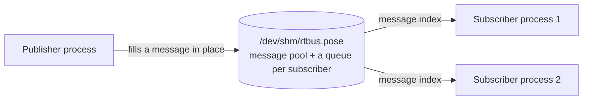

# rtbus

[](https://github.com/AvivE453/rtbus/actions/workflows/ci.yml)

A brokerless publish/subscribe middleware for real-time systems on Linux, written in C++17: a
small version of what DDS, eCAL and iceoryx do inside robots and cars.

The problem it solves: in a robot, processes hand each other sensor data (poses, point clouds,
camera frames) hundreds of times a second. Sending it through a socket or a broker copies every
message on the way and adds latency that grows with its size, and a central broker is one more
process that can crash. rtbus hands a message over through shared memory without copying it,
has no broker, and keeps working when a process on either end is killed.

> **Status:** the shared-memory transport works between processes on one host. The UDP
> transport for other hosts is next.

## Example

```cpp
#include "rtbus/node.hpp"

struct Pose {
  double x;
  double y;
};

// Process A
rtbus::Node estimator("estimator");
auto publisher = estimator.advertise<Pose>("pose");

auto pose = publisher.loan();  // a message in shared memory, filled in place
pose->x = 1.0;
pose->y = 2.0;
publisher.publish(std::move(pose));  // nothing is copied, and nobody is waited for

publisher.publish(Pose{3.0, 4.0});  // or copy a message in

// Process B
rtbus::Node planner("planner");
auto subscriber = planner.subscribe<Pose>(
    "pose", [](const Pose& pose) { /* runs on this subscriber's own thread */ });
```

A subscriber can start before or after its publisher, and it reconnects on its own when the
publisher is restarted or replaced.

## How it works



- **Zero-copy:** subscribers read the publisher's message where it was written. Reference
  counts return it to the pool once every subscriber is done with it.
- **The publisher never waits:** each subscriber has its own lock-free queue, and one that falls
  behind loses its oldest messages.
- **Futex wake-up:** an idle subscriber sleeps in the kernel until a message arrives, or
  busy-polls for the lowest latency.
- **Crash recovery:** every process holds a byte-range lock that the kernel releases when it
  dies, even by `kill -9`, so the others notice and take back what it held.

The design in more depth, with the limits: [docs/design.md](docs/design.md).

## Performance

Median one-way latency between two processes on a laptop, one message per millisecond:

| | 64 B | 1 MB |
|---|---:|---:|
| Unix domain socket | 3.5 µs | 167 µs |
| rtbus, sleeping subscriber | 2.5 µs | 3.1 µs |
| rtbus, busy-polling subscriber | 0.4 µs | 0.4 µs |

The two top rows were measured with CPU idle states kept out. The method, every percentile and
the caveats: [bench/RESULTS.md](bench/RESULTS.md).

## Roadmap

| Phase | Scope | Status |
|---|---|---|
| 0 | Build system, sanitizers, CI, RAII wrappers for `fd` and shared memory | Done |
| 1 | Pub/sub API: `Node`, `Publisher<T>`, `Subscriber<T>` | Done |
| 2 | Shared-memory transport: lock-free queues, zero-copy loans, futex wake-up, crash recovery, latency benchmarks | Done |
| 3 | UDP transport, multicast discovery, fragmentation | Planned |
| 4 | QoS (best-effort, reliable, deadline), `SCHED_FIFO`, zero allocations on the hot path | Planned |
| 5 | Message code generator, CLI tools, end-to-end demo | Planned |

## Building

Requires Linux, GCC 10 or newer, CMake 3.21+ and Ninja. GoogleTest and Google Benchmark are
downloaded at configure time.

```bash
cmake --preset debug
cmake --build --preset debug
ctest --preset debug
```

The `asan` and `tsan` presets run the same tests under the sanitizers. More on the presets and
the stress test: [docs/design.md](docs/design.md#build-presets).
